# NC Ocorrências: gestão de ocorrências de entrega na Power Platform

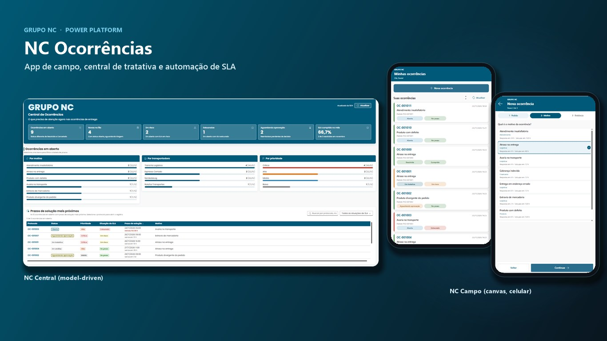

O [dashboard do Grupo NC](https://danielresende23.github.io/Portfolio/#dashboards) mostra onde a operação perde: mais de 40% dos pedidos atrasam, e o atraso logístico é o principal motivo de ocorrência. Este projeto é o passo seguinte. Ele cria **onde cada ocorrência é aberta, tratada, aprovada e respondida**, com prazo, responsável e histórico, sem e-mail, planilha ou WhatsApp.

> **Status:** a fase 1 está concluída e testada de ponta a ponta. Ela inclui a solution, o Dataverse, o NC Central, o NC Campo e os fluxos de abertura e de protocolo. As fases 2 e 3 estão no [roteiro](#roteiro). Todos os dados são fictícios.

## O que já funciona

| Peça | Tecnologia | O que faz |
|---|---|---|
| **NC Campo** | Power Apps (canvas, celular) | O motorista abre a ocorrência em 3 passos. Primeiro informa o pedido, pelo código de barras ou pela busca. Depois escolhe o motivo. Por fim registra a evidência: foto, localização e descrição. Recebe o protocolo na hora. |
| **NC Central** | Power Apps (model-driven) | A central faz a triagem e a tratativa. Tem painel com KPIs e gráficos, 11 visões (fila, SLA em risco, aguardando aprovação…) e o fluxo de processo "Tratativa NC" em 5 etapas. Também tem formulários com linha do tempo e três perfis de segurança. |
| **Dados** | Dataverse | Solution `NCOcorrencias` com prefixo `nc` e 5 tabelas próprias: Ocorrência, Pedido, Motivo, Transportadora e Interação. Usa Conta e Contato padrão, numeração automática (`OC-000000`), chaves alternativas e auditoria. |
| **NC - Ocorrência - Abertura** | Power Automate (gatilho do Dataverse) | Calcula os prazos de SLA pelo motivo e a prioridade, que sobe para Crítica acima de R$ 10 mil. Completa cliente e transportadora a partir do pedido e registra a interação de abertura. |
| **NC - App - Protocolo** | Power Automate (gatilho Power Apps V2) | Espera os prazos, manda o comprovante por e-mail ao contato e devolve o protocolo e os prazos ao app. |

## Demonstração

### NC Campo: o motorista abre a ocorrência pelo celular

<table>
  <tr>
    <td align="center">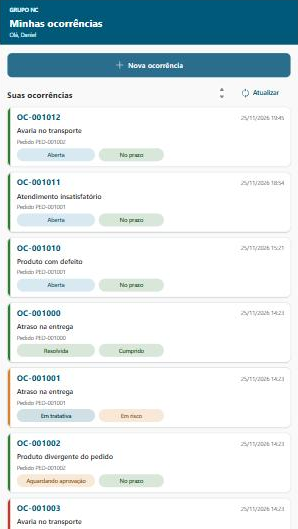 1. Minhas ocorrências</td>
    <td align="center">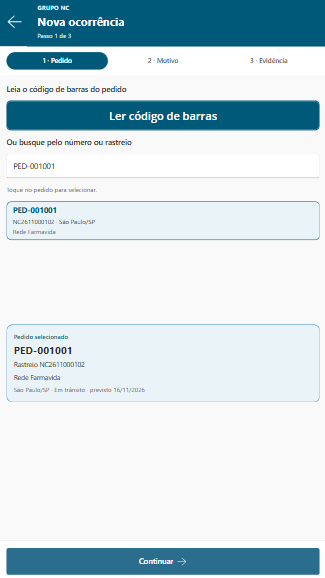 2. Pedido (código de barras ou busca)</td>
    <td align="center">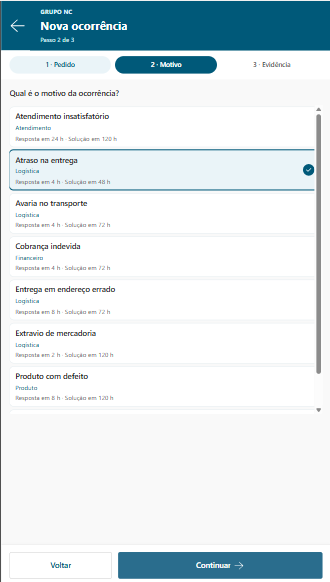 3. Motivo com SLA</td>
  </tr>
  <tr>
    <td align="center">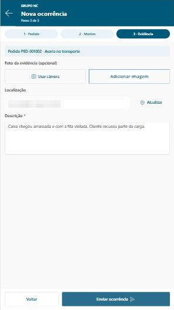 4. Evidência</td>
    <td align="center">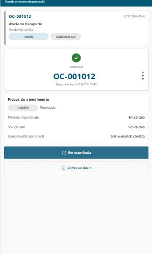 5. Protocolo devolvido pelo fluxo</td>
    <td align="center">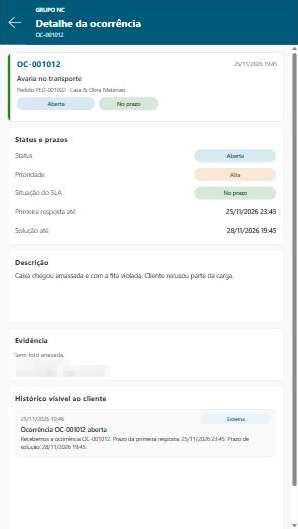 6. Detalhe e histórico</td>
  </tr>
</table>

### NC Central: a central trata a fila

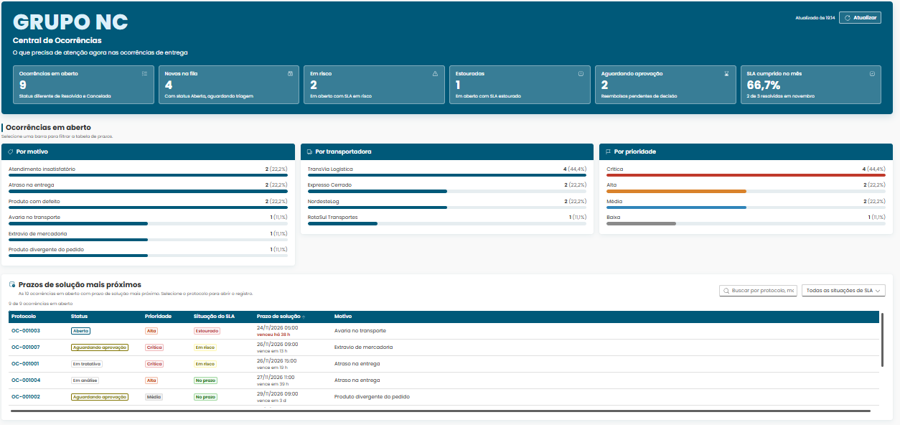

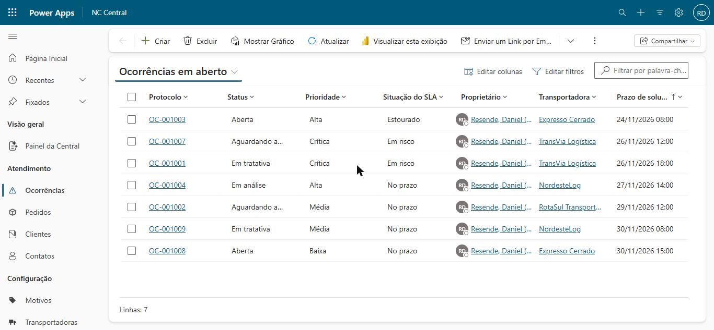

### Evidências da construção

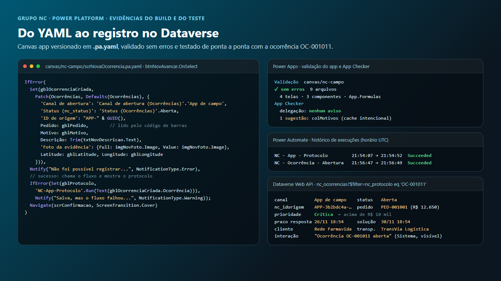

<table>
  <tr>
    <td width="50%">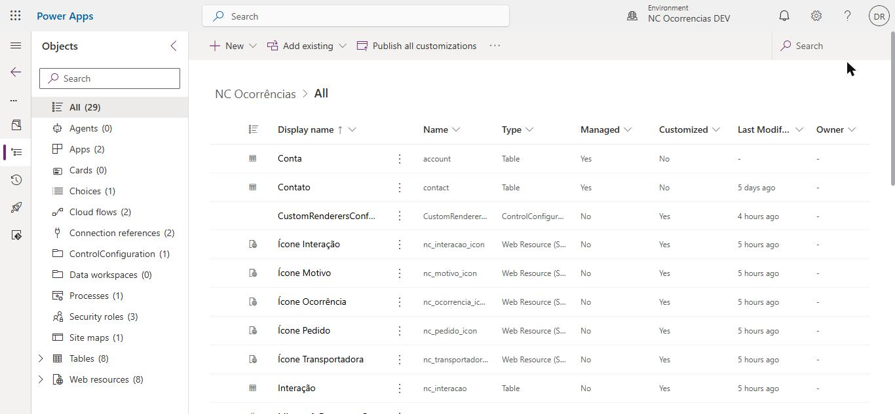 Solution <b>NC Ocorrências</b>: 29 componentes, entre tabelas, apps, fluxos, referências de conexão, perfis de segurança e fluxo de processo</td>
    <td width="50%">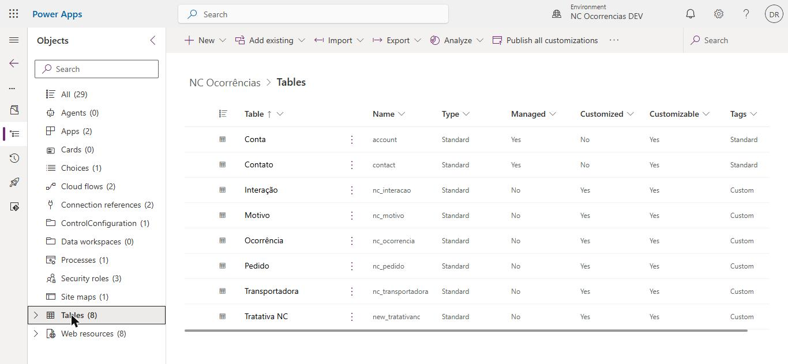 Tabelas: Conta e Contato padrão e as cinco tabelas <code>nc_</code></td>
  </tr>
  <tr>
    <td>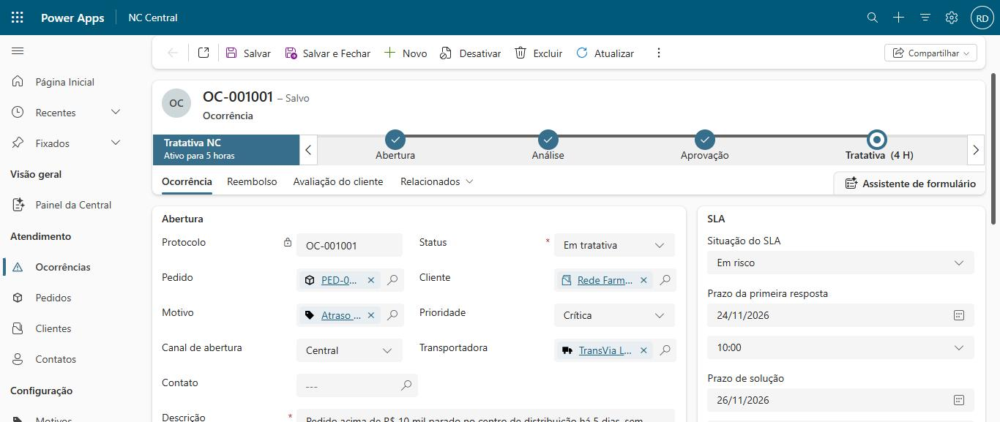 NC Central: fluxo de processo <b>Tratativa NC</b> no formulário da ocorrência</td>
    <td>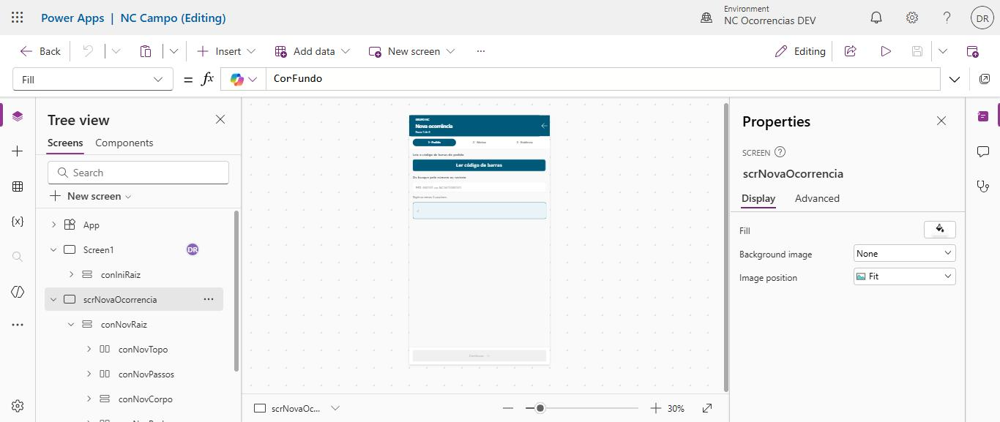 NC Campo no Power Apps Studio: 4 telas em contêineres responsivos</td>
  </tr>
  <tr>
    <td>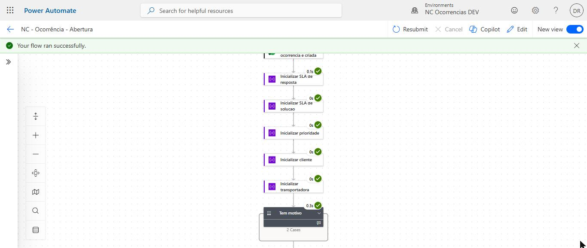 Execução do <b>NC - Ocorrência - Abertura</b> para a OC-001011</td>
    <td>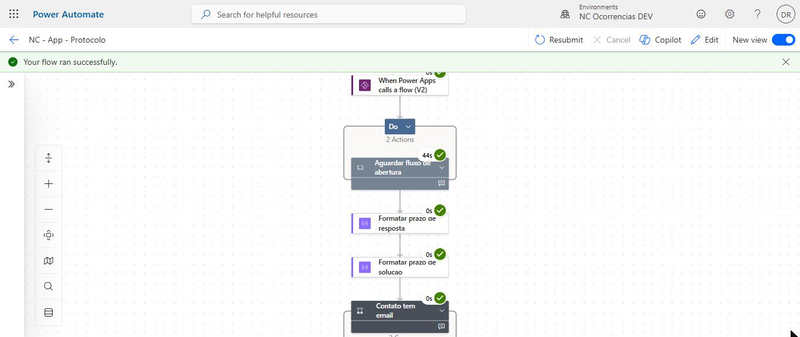 Execução do <b>NC - App - Protocolo</b> chamada pelo app (espera de 44 s pelos prazos)</td>
  </tr>
</table>

Os demais prints (colunas, componente no Studio e o fim da execução do fluxo) estão no [passo a passo](docs/passo-a-passo.md).

## Como as peças se conectam

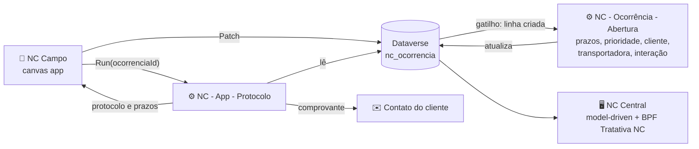

O desenho completo, com personas, processo, regras de negócio, segurança e ALM, está em [docs/arquitetura.md](docs/arquitetura.md).

## Destaques técnicos

**Canvas app (NC Campo)**
- O código-fonte do app está versionado em **YAML (`.pa.yaml`)**, o formato de código-fonte do Power Apps: telas, componentes e fórmulas ficam legíveis e revisáveis no Git.
- **Consultas delegáveis ao Dataverse:**
  - "minhas ocorrências" filtra `'Criada Por'` = usuário atual;
  - o código de barras faz `LookUp` pelo rastreio;
  - a busca usa `StartsWith` no número ou no rastreio;
  - o histórico filtra pela ocorrência e pela visibilidade ao cliente.
- **Componentes próprios:** cabeçalho, card de ocorrência e selo de status. As cores e a fonte do Grupo NC ficam como fórmulas nomeadas e funções (`CorSLA()`, `CorPrioridade()`, `CorStatus()`) em `App.Formulas`.
- **Envio:** `Patch` com `IfError` e `Notify`, e a foto gravada na coluna de imagem. A chamada do fluxo tem um `IfError` próprio, então uma falha no comprovante não desfaz a ocorrência.

**Dataverse e model-driven (NC Central)**
- Modelo relacional com Conta e Contato padrão, que o Power Pages vai usar no portal, e escolhas globais.
- Fluxo de processo "Tratativa NC": Abertura → Análise → Aprovação → Tratativa → Encerramento.
- Painel como página gerada (React/TypeScript) com a identidade visual do Grupo NC e tema próprio do app.
- Perfis **NC Atendente**, **NC Supervisor** e **NC Gestor**, cada um com o escopo de acesso por tabela.

**Power Automate**
- **Abertura assíncrona:** a regra de negócio fica no servidor, então qualquer canal (app, portal, central ou agente) recebe os mesmos prazos e a mesma prioridade.
- **Protocolo síncrono:** gatilho Power Apps V2 com resposta tipada (`protocolo`, `prazoresposta`, `prazosolucao`, `emailenviado`).

## Passo a passo

Como o projeto foi construído, etapa por etapa, com os prints e o teste de ponta a ponta: **[docs/passo-a-passo.md](docs/passo-a-passo.md)**.

Os detalhes do app de campo, com decisões de Power Fx e limitações, estão em [docs/nc-campo.md](docs/nc-campo.md).

## Estrutura do repositório

| Pasta | Conteúdo |
|---|---|
| `docs/` | Arquitetura, passo a passo, registro do NC Campo, valores das escolhas (`opcoes.json`) e prints |
| `canvas/nc-campo/` | Código-fonte do canvas app: telas, componentes e `App.Formulas` em `.pa.yaml` |
| `model-driven/nc-central/` | Especificação do NC Central (`app-spec.json`), documento de desenho e página do painel (`painel-central.tsx`) |
| `flows/` | Definição dos dois fluxos do Power Automate (JSON) |
| `scripts/` | Scripts Node de apoio: teste do fluxo de abertura, leitura das escolhas e aplicação do fluxo de processo |

## Roteiro

1. **Base** ✅: solution, tabelas, dados fictícios, NC Central, NC Campo e os fluxos de abertura e de protocolo.
2. **Automação e canais:**
   - aprovação de reembolso por alçada no Teams;
   - monitor de SLA;
   - Portal do Cliente em Power Pages;
   - agente Assistente NC no Copilot Studio;
   - lançamento do crédito por RPA com Power Automate Desktop.
3. **Entrega:** relatório de Power BI sobre o Dataverse e ALM com `pac solution unpack`, GitHub Actions e Pipelines.

## Autor

**Daniel Resende**, Analista de BI Sênior | Analytics Engineer. [Portfólio](https://danielresende23.github.io/Portfolio) · [LinkedIn](https://www.linkedin.com/in/daniel-resend/)
