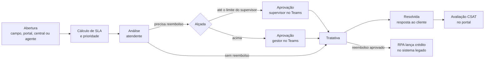
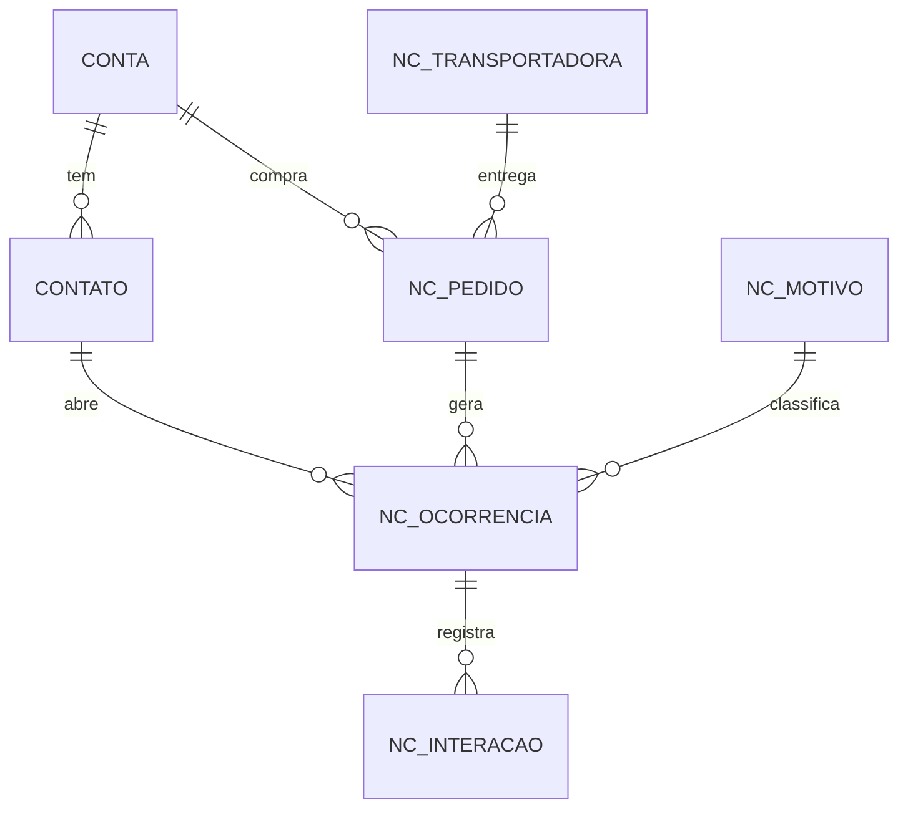

# Arquitetura: NC Ocorrências

Desenho da solução, antes da construção. Este documento é a referência para criar as tabelas, os apps e os fluxos, e vai ser atualizado conforme o projeto avança.

## Contexto

O Grupo NC é a empresa fictícia do [Dashboard de Performance Comercial e Operacional](https://danielresende23.github.io/Portfolio). O dashboard mostra que:
- a taxa de atraso passa de 40%;
- SP concentra a pressão logística;
- o principal motivo de ocorrência é o atraso logístico.

O que falta é **onde a operação resolve** cada ocorrência, com prazo, responsável, aprovação e retorno ao cliente. Hoje isso fica em e-mail, planilha e WhatsApp. É esse o problema que o NC Ocorrências resolve.

## Personas e canais

| Persona | Canal | O que faz |
|---|---|---|
| Motorista e atendente de campo | Canvas app **NC Campo** (celular) | Abre a ocorrência pelo código do pedido, com foto, localização e descrição |
| Cliente (empresa compradora) | **Portal do Cliente** em Power Pages | Abre ocorrência para os seus pedidos, acompanha o status e avalia o atendimento |
| Atendente da central | Model-driven app **NC Central** | Tria, trata e responde ao cliente |
| Supervisor | NC Central e Teams | Aprova reembolsos dentro da alçada e acompanha o SLA da fila |
| Gestor | NC Central, Teams e Power BI | Aprova acima da alçada do supervisor e acompanha os indicadores |
| Qualquer pessoa do time | Agente **Assistente NC** no Teams | Pergunta o status por protocolo e abre ocorrência conversando |

## Processo

## Modelo de dados (Dataverse)

Publisher **Grupo NC**, prefixo `nc`, solution **NCOcorrencias**.

Para cliente e contato, uso as tabelas padrão **Conta** e **Contato**. É a boa prática do Dataverse e é o que o Power Pages usa para login e permissões.

**nc_transportadora**: Transportadora
- Nome (nome principal) e CNPJ fictício.
- Região de atuação (escolha: Sudeste, Sul, Centro-Oeste, Nordeste, Norte).
- SLA contratual de entrega, em dias.
- Ativo (sim ou não).

**nc_pedido**: Pedido
- Número (nome principal, numeração automática `PED-{SEQNUM:6}`).
- Relacionamentos: conta (cliente) e transportadora.
- Datas: do pedido, de entrega prevista e de entrega realizada.
- Destino: UF e cidade.
- Valor do pedido (moeda) e código de rastreio.
- Status (escolha: Em separação, Em trânsito, Entregue, Devolvido, Cancelado).

**nc_motivo**: Motivo da ocorrência (tabela de configuração)
- Nome.
- Categoria (escolha: Logística, Produto, Atendimento, Financeiro).
- SLA de primeira resposta e SLA de solução, em horas.
- Prioridade padrão.
- Pode gerar reembolso (sim ou não).
- Ativo.

**nc_ocorrencia**: Ocorrência
- Protocolo (nome principal, numeração automática `OC-{SEQNUM:6}`).
- Relacionamentos: pedido; conta, transportadora e contato (preenchidos a partir do pedido); motivo.
- Canal (escolha: App de campo, Portal do cliente, Central, Assistente Teams).
- Prioridade (escolha: Baixa, Média, Alta, Crítica).
- Status (status reason): Aberta, Em análise, Aguardando aprovação, Em tratativa, Resolvida, Cancelada.
- Descrição e solução aplicada.
- Evidência: foto (coluna de imagem), latitude e longitude.
- Prazos: prazo da primeira resposta, prazo de solução e data de resolução.
- Situação do SLA (escolha: No prazo, Em risco, Estourado, Cumprido, Não cumprido).
- Reembolso: valor solicitado (moeda), status da aprovação (escolha: Não necessária, Pendente, Aprovada, Reprovada), aprovador e comentário da aprovação.
- Lançado no sistema legado (sim ou não) e número do lançamento.
- CSAT (1 a 5) e comentário do cliente.

**nc_interacao**: Interação (histórico)
- Relacionamento: ocorrência.
- Tipo (escolha: Comentário interno, Resposta ao cliente, Mudança de status, Sistema).
- Texto.
- Visível ao cliente (sim ou não). O portal mostra só o que for visível.

## Regras de negócio

- **Prazos:** na abertura, os prazos vêm do motivo:
  - prazo da primeira resposta = abertura + SLA de primeira resposta;
  - prazo de solução = abertura + SLA de solução.

  A prioridade vem do motivo, mas sobe para Crítica quando o pedido passa de R$ 10 mil.
- **Situação do SLA:**
  - **Em risco** quando faltam menos de 20% do prazo;
  - **Estourado** quando passa do prazo;
  - na resolução, vira **Cumprido** ou **Não cumprido**.
- **Alçada de reembolso** (em variáveis de ambiente):
  - até `nc_LimiteSupervisor` (R$ 500), aprova o supervisor;
  - até `nc_LimiteGestor` (R$ 5.000), aprova o gestor;
  - acima disso, aprova a diretoria.
- **Bloqueio:** uma ocorrência com reembolso pendente não pode ser resolvida (regra de negócio no formulário e validação no fluxo).

## Segurança

| Perfil | Ocorrências | Pedidos, contas e transportadoras | Motivos |
|---|---|---|---|
| NC Atendente | Criar, ler e editar as suas e as sem responsável | Ler | Ler |
| NC Supervisor | Tudo da unidade de negócio e aprovar até a sua alçada | Ler | Ler |
| NC Gestor | Tudo | Tudo | Tudo |
| Web role **Cliente** (portal) | Criar e ler só as da sua conta | Ler só os pedidos da sua conta | Ler |

A auditoria fica ligada em ocorrência e interação.

## Apps

**NC Campo**: canvas app, layout de celular
- Na tela inicial, a pessoa vê as ocorrências que abriu, com a situação do SLA em cores.
- Para abrir uma ocorrência:
  1. lê o código de barras do pedido ou busca pelo número;
  2. escolhe o motivo;
  3. tira a foto;
  4. o app captura a localização;
  5. a pessoa descreve e envia.
- Detalhes técnicos:
  - Power Fx com `Patch`, `IfError` e `Notify`;
  - coleções e consultas delegáveis;
  - uma biblioteca de componentes própria (cabeçalho, card de ocorrência, selo de status).
- Depois de salvar, chama o fluxo de protocolo e mostra o número para a pessoa.

**NC Central**: model-driven app
- **Menu:** Ocorrências, Pedidos, Clientes, Transportadoras e, em Configuração, Motivos.
- **Visões:**
  - Minhas ocorrências;
  - Fila sem responsável;
  - SLA em risco ou estourado;
  - Aguardando aprovação;
  - Resolvidas no mês.
- **Formulário da ocorrência:**
  - fluxo de processo de negócio "Tratativa": Abertura → Análise → Aprovação → Tratativa → Encerramento;
  - linha do tempo com as interações;
  - foto e mapa.
- **Painel:** gráficos nativos e o relatório de Power BI incorporado.

**Portal do Cliente**: Power Pages
- Login do contato do cliente.
- O cliente abre uma ocorrência escolhendo um dos seus pedidos e acompanha o status e as respostas visíveis.
- Depois da resolução, avalia o atendimento (CSAT).

## Automação (Power Automate)

| Fluxo | Gatilho | O que faz |
|---|---|---|
| `NC - Ocorrência - Abertura` | Ocorrência criada | Calcula prazos e prioridade, preenche conta e transportadora a partir do pedido, registra interação de sistema e avisa o supervisor no Teams se for Crítica |
| `NC - Ocorrência - Aprovação de reembolso` | Status muda para Aguardando aprovação | Define o aprovador pela alçada, manda aprovação com card no Teams, grava o resultado e a interação e devolve para tratativa |
| `NC - SLA - Monitor` | Agendado, a cada hora | Atualiza a situação do SLA, escala as ocorrências estouradas para o gestor no Teams e manda um resumo diário por e-mail |
| `NC - App - Protocolo` | Chamado pelo Power Apps (com retorno) | Gera o comprovante da ocorrência em PDF, envia por e-mail ao contato e devolve o protocolo para o app |
| `NC - RPA - Lançar crédito` | Reembolso aprovado | Chama um fluxo da área de trabalho (Power Automate Desktop) que lança o crédito numa tela de "sistema legado" simulado e grava o número do lançamento |

## Agente (Copilot Studio)

O **Assistente NC** fica publicado no Teams e tem três partes:
- **Consultar status:** a pessoa informa o protocolo e o agente responde o status, o prazo e a última interação visível. Usa uma ação com fluxo.
- **Abrir ocorrência:** a pessoa informa o número do pedido, o motivo e a descrição, e o agente cria a ocorrência pelo canal Assistente Teams.
- **Base de conhecimento:** política de reembolso e prazos por motivo, num documento da solution.

## Power BI

O relatório **NC Ocorrências e SLA** é ligado ao Dataverse e traz:
- volume de ocorrências;
- % no prazo e tempo médio até a primeira resposta e até a solução;
- motivos, transportadoras e UFs;
- reembolsos por alçada;
- CSAT.

Ele aparece incorporado no painel do NC Central.

## ALM

- **Solution:** tudo fica numa solution não gerenciada no ambiente de desenvolvimento, com publisher próprio, referências de conexão e variáveis de ambiente:
  - limites de alçada;
  - e-mail do gestor;
  - URL do portal;
  - percentual de alerta do SLA.
- **Código-fonte no GitHub:** a solution é exportada e aberta em arquivos (`pac solution unpack`) na pasta `solution/`. O canvas app também fica em código-fonte.
- **GitHub Actions:** a cada push, empacota a solution e roda o Solution Checker.
- **Deploy:** a solution vai para o ambiente de teste como gerenciada, com Pipelines da Power Platform.

## Convenções

- **Nomes:** tabelas e colunas em português, sem acento no nome lógico (`nc_ocorrencia`) e com acento no nome de exibição (Ocorrência).
- **Fluxos:** `NC - Área - Ação`.
- **Variáveis de ambiente:** `nc_NomeEmPascalCase`.
- **Dados:** fictícios, gerados por script com semente fixa (`data/gerar_dados.py`), de forma que qualquer pessoa consiga recriar.

## Fases

1. **Base:** solution, tabelas, dados fictícios, NC Central, NC Campo e os fluxos de abertura e de protocolo.
2. **Automação e canais:** aprovação de reembolso, monitor de SLA, Portal do Cliente, Assistente NC e RPA.
3. **Entrega:** Power BI, ALM com GitHub Actions e Pipelines, README com prints e vídeo, e atualização do portfólio, do LinkedIn e do currículo.

## Pré-requisitos

- **Ambiente:** um ambiente **Developer** só para este projeto. Nada é criado nos ambientes de cliente ou no ambiente padrão da empresa.
- **Login:** `pac auth create` com o ambiente do projeto selecionado. O login é feito no navegador.
- **Licenças:** podem ser necessárias licenças de avaliação para Copilot Studio, Power Pages e para rodar fluxo da área de trabalho a partir de um fluxo de nuvem.
- **RPA:** precisa do Power Automate Desktop instalado.
