# Passo a passo: como o NC Ocorrências foi construído (fase 1)

Este é o roteiro da construção, na ordem em que aconteceu. Cada etapa diz o que foi feito, por que e como conferir. O desenho de referência está em [arquitetura.md](arquitetura.md).

**Índice**
1. [Ambiente e solution](#1-ambiente-e-solution)
2. [Modelo de dados no Dataverse](#2-modelo-de-dados-no-dataverse)
3. [NC Central (model-driven)](#3-nc-central-model-driven)
4. [Fluxo NC - Ocorrência - Abertura](#4-fluxo-nc---ocorrência---abertura)
5. [Fluxo NC - App - Protocolo](#5-fluxo-nc---app---protocolo)
6. [NC Campo (canvas app)](#6-nc-campo-canvas-app)
7. [Teste de ponta a ponta](#7-teste-de-ponta-a-ponta)
8. [Publicação e código-fonte](#8-publicação-e-código-fonte)

---

## 1. Ambiente e solution

**O que foi feito**
- **Ambiente:** um ambiente **Developer** criado só para o projeto, o "NC Ocorrencias DEV". Nada foi feito nos ambientes de cliente nem no ambiente padrão.
- **Publisher:** **Grupo NC**, com prefixo `nc`.
- **Solution:** **NC Ocorrências** (`NCOcorrencias`), não gerenciada. Todo componente (tabelas, apps, fluxos, conexões) nasce dentro dela.
- **CLI:** o `pac` foi apontado para o ambiente com `pac auth create` e `pac org select`.

**Por quê:** uma solution própria com publisher próprio permite exportar, versionar e levar para teste ou produção como gerenciada (ALM). Esse é o assunto da fase 3.

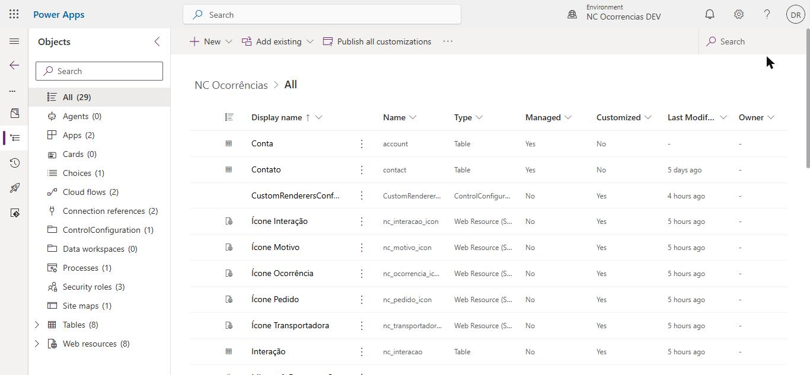

---

## 2. Modelo de dados no Dataverse

**O que foi feito**
- **Tabelas novas:** cinco, com nome lógico sem acento e nome de exibição com acento:
  - `nc_ocorrencia` (Ocorrência), com protocolo automático `OC-{SEQNUM:6}`;
  - `nc_pedido` (Pedido), com número automático `PED-{SEQNUM:6}`;
  - `nc_motivo` (Motivo), a tabela de configuração com os SLAs em horas, a prioridade padrão e se o motivo gera reembolso;
  - `nc_transportadora` (Transportadora);
  - `nc_interacao` (Interação), o histórico, com a marcação "Visível ao cliente".
- **Tabelas padrão:** cliente e contato usam Conta e Contato, porque é o que o Power Pages usa para login e permissões.
- **Chaves alternativas:** `nc_rastreio` no pedido, que o leitor de código de barras usa, e `nc_idorigem` na ocorrência, que evita duplicar quando o mesmo canal reenvia.
- **Escolhas:** a prioridade é uma escolha global (Baixa, Média, Alta, Crítica). Os valores numéricos de cada escolha estão em [opcoes.json](opcoes.json).
- **Dados fictícios:** 5 contas, 4 transportadoras, 8 motivos, 10 pedidos (rastreios `NC2611000101` a `NC2611000110`) e 10 ocorrências de exemplo.

**Como conferir:** `pac model list-tables --search nc_` lista as cinco tabelas, e o script [`scripts/ler-opcoes.js`](../scripts/ler-opcoes.js) lê os valores das escolhas.

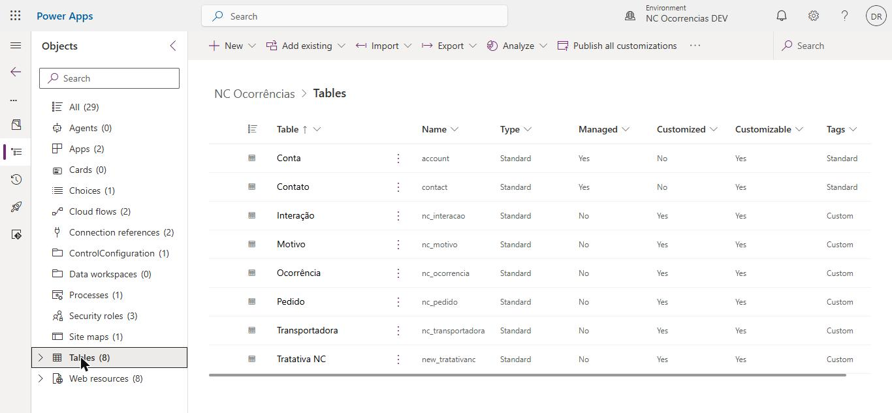

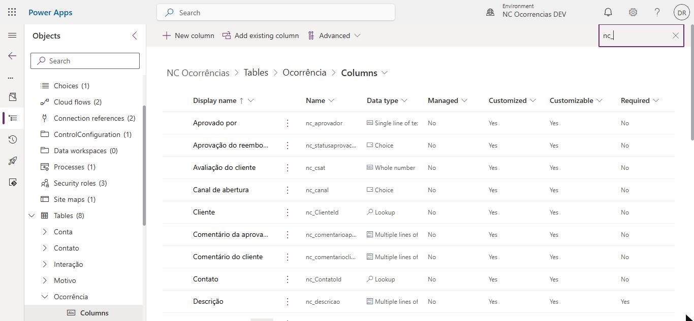

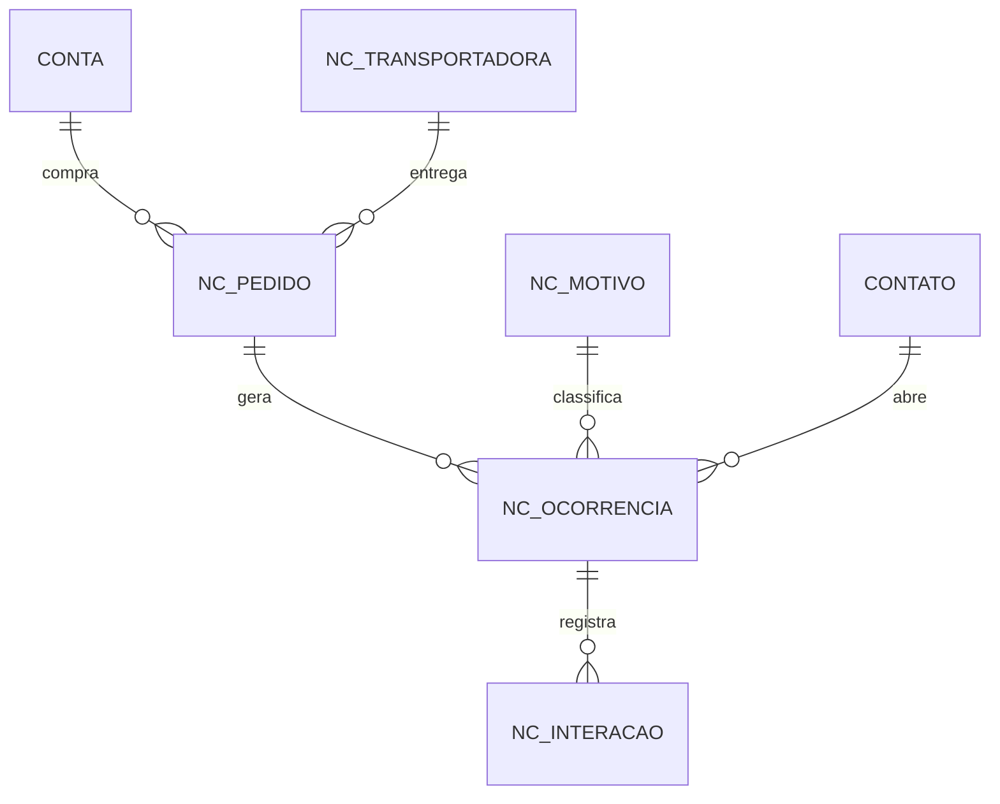

---

## 3. NC Central (model-driven)

**O que foi feito.** O app foi descrito numa especificação ([`model-driven/nc-central/app-spec.json`](../model-driven/nc-central/app-spec.json)) com tabelas, visões, formulários, gráficos, perfis e menu, e criado a partir dela. Antes, a especificação foi validada num *dry-run*. O app ficou assim:
- **Menu:** "Visão geral", com o painel; "Atendimento", com Ocorrências, Pedidos, Clientes e Contatos; e "Configuração", com Motivos e Transportadoras.
- **11 visões:**
  - Minhas ocorrências em aberto, Novas ocorrências na fila, SLA em risco ou estourado, Aguardando aprovação, Ocorrências em aberto e Resolvidas no mês;
  - Ocorrências recentes, Pedidos recentes, Motivos ativos, Transportadoras ativas e Interações recentes.
- **6 formulários:** o da ocorrência tem 3 abas e a subgrade de interações, e há um formulário rápido para "Nova interação".
- **6 gráficos:** por situação do SLA, status, prioridade, canal, status do pedido e categoria do motivo.
- **Fluxo de processo "Tratativa NC":** Abertura → Análise → Aprovação → Tratativa → Encerramento.
- **Painel da Central:** uma página gerada em React/TypeScript ([`painel-central.tsx`](../model-driven/nc-central/painel-central.tsx)) com KPIs, gráficos e as 10 ocorrências de prazo mais próximo.
- **Perfis de segurança:** NC Atendente, NC Supervisor e NC Gestor.

**Identidade visual:** a mesma do dashboard do Grupo NC, com tema próprio do app (azul petróleo `#005979`, fonte Poppins), cabeçalho "GRUPO NC" e sem logo.

**Ajustes depois do build**
- **Chaves alternativas:** num Dataverse em pt-BR, o construtor não reconheceu "Já existe uma chave de entidade". O build seguiu com uma cópia da especificação sem as chaves, que já existiam.
- **Fluxo de processo:** foi incluído no app com `AddAppComponents`. As ocorrências de exemplo, criadas antes dele, ganharam a instância com [`scripts/aplicar-bpf-existentes.js`](../scripts/aplicar-bpf-existentes.js).

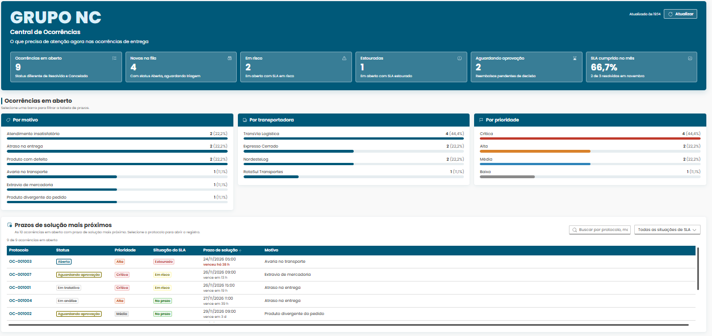

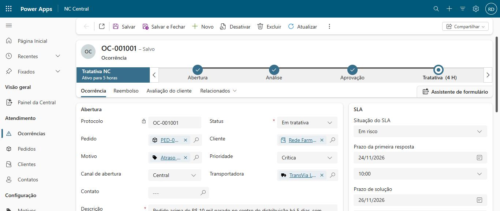

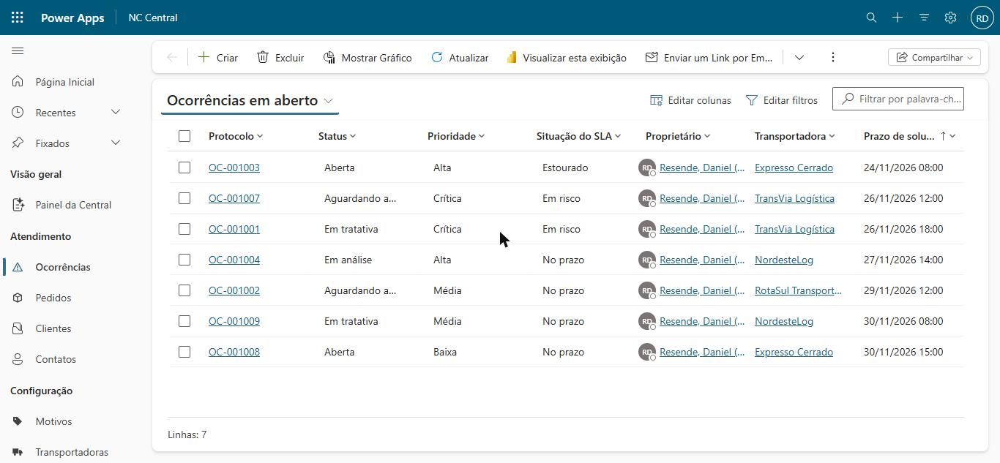

---

## 4. Fluxo NC - Ocorrência - Abertura

**Gatilho:** linha criada em `nc_ocorrencia`, com escopo de organização. Vale para qualquer canal: app de campo, portal, central ou agente. A definição está em [`flows/nc-ocorrencia-abertura.json`](../flows/nc-ocorrencia-abertura.json).

**O que faz**
1. Lê o **motivo** e guarda o SLA de primeira resposta, o SLA de solução e a prioridade padrão. Sem motivo, usa 24 h, 72 h e prioridade Média.
2. Lê o **pedido**: se o valor passa de **R$ 10 mil**, a prioridade sobe para **Crítica**. O cliente e a transportadora também vêm do pedido.
3. Grava os prazos (abertura + SLA), a prioridade, a situação do SLA ("No prazo") e completa cliente e transportadora quando a ocorrência chegou sem eles.
4. Cria a **interação de sistema** "Ocorrência OC-… aberta", visível ao cliente.

**Por que no servidor:** a regra fica num só lugar, e todos os canais recebem o mesmo cálculo.

**Como conferir:** [`scripts/testar-fluxo-abertura.js`](../scripts/testar-fluxo-abertura.js) cria uma ocorrência pela Web API e espera o fluxo preencher os campos. Foi assim que a OC-001010 foi testada.

| Execução da OC-001011: início | Execução da OC-001011: fim |
|---|---|
| 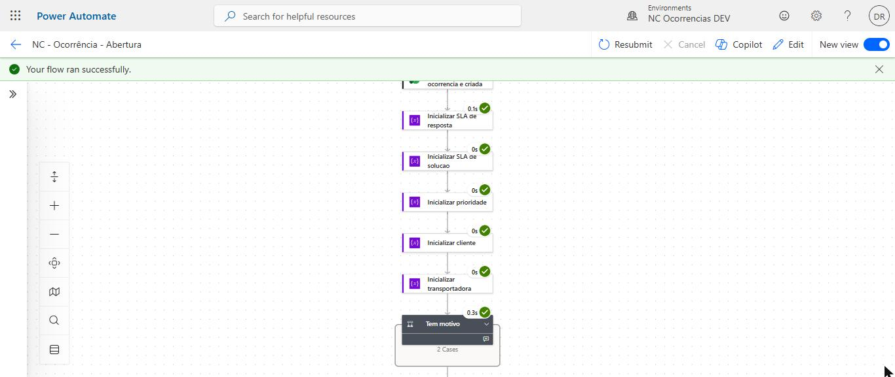 | 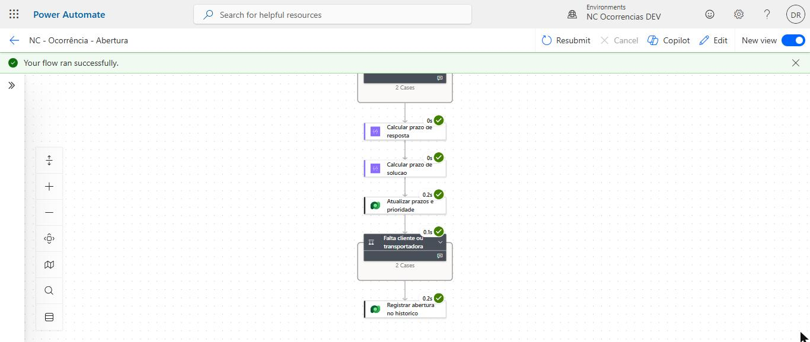 |

---

## 5. Fluxo NC - App - Protocolo

**Gatilho:** Power Apps V2, com uma entrada de texto, `ocorrenciaId`. A definição está em [`flows/nc-app-protocolo.json`](../flows/nc-app-protocolo.json).

**O que faz**
1. Espera até cerca de 45 s o fluxo de abertura preencher os prazos, porque esse fluxo é assíncrono.
2. Formata os prazos no fuso de Brasília.
3. Se a ocorrência tem um contato com e-mail, manda o comprovante em HTML com a identidade do Grupo NC (Office 365 Outlook).
4. Responde ao app com `protocolo`, `prazoresposta`, `prazosolucao` e `emailenviado`.

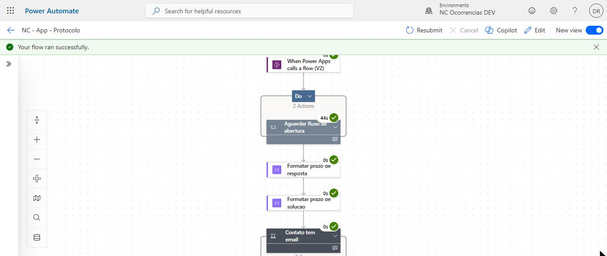

---

## 6. NC Campo (canvas app)

O registro completo, com decisões de Power Fx e limitações, está em [nc-campo.md](nc-campo.md). Aqui fica a sequência.

1. **App criado dentro da solution:** em Soluções → NC Ocorrências → Novo → Aplicativo de tela, no formato **Telefone**.
2. **Dados adicionados pelo Studio:** as tabelas Ocorrências, Pedidos, Motivos, Interações e Usuários, e o fluxo NC - App - Protocolo.
3. **Fórmulas do app** (`App.Formulas` e `App.OnStart`):
   - o tema do Grupo NC (cores e fonte);
   - as funções `CorSLA()`, `CorPrioridade()` e `CorStatus()`;
   - as consultas `UsuarioAtual` e `MinhasOcorrencias`, delegáveis;
   - a coleção `colMotivos`, com o cache dos motivos ativos.
4. **Componentes:** `cmpCabecalho`, `cmpSeloStatus` e `cmpCardOcorrencia`, feitos e testados antes das telas.
5. **Fórmulas críticas validadas** antes de montar as telas:
   - o `Patch` com escolhas, consultas e a foto (a coluna de imagem exige `{Full, Value}`);
   - a leitura do código de barras: `First(Self.Barcodes.Value).Value`;
   - a chamada `'NC-App-Protocolo'.Run(...)`.
6. **As 4 telas:**
   - Início;
   - Nova ocorrência, com 3 passos e um rodapé fixo com "Voltar" e "Continuar"/"Enviar";
   - Confirmação;
   - Detalhe.
7. **Verificação:** nenhum erro de fórmula e o App Checker sem avisos de delegação.
8. **Código-fonte:** a versão salva no Studio fica em `.pa.yaml`, em [`canvas/nc-campo/`](../canvas/nc-campo).

**Detalhe do Power Apps que pegou.** Ao salvar, o Power Apps grava as instâncias de componente antes dos outros controles do mesmo contêiner. Assim, um selo pensado para ficar à direita do rótulo aparece à esquerda. A solução foi pôr os selos e o card dentro de contêineres próprios.

| Studio: telas e árvore de controles | Studio: componente `cmpCardOcorrencia` e propriedades personalizadas |
|---|---|
| 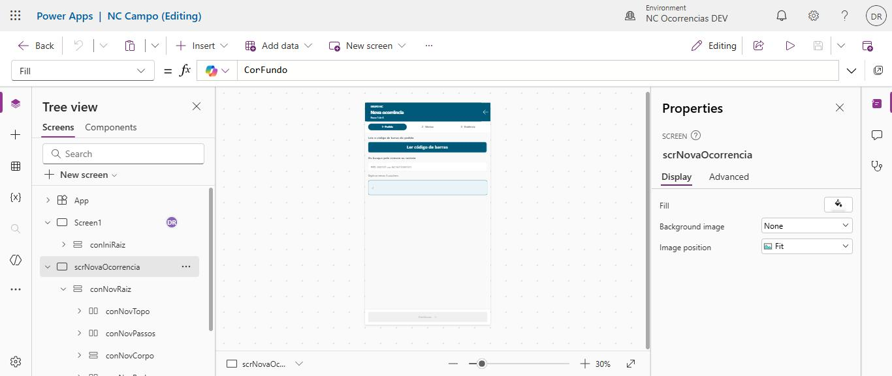 | 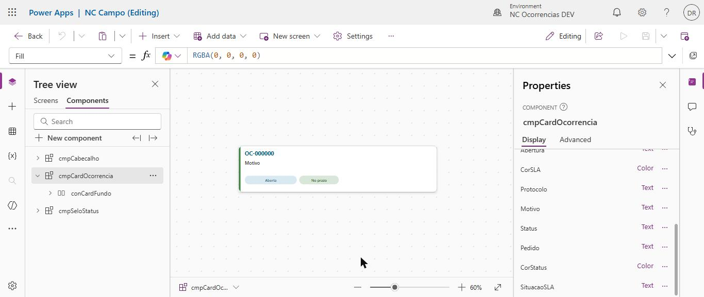 |

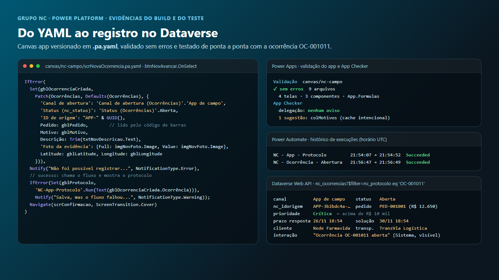

| Início | Passo 1: pedido | Passo 2: motivo |
|---|---|---|
| 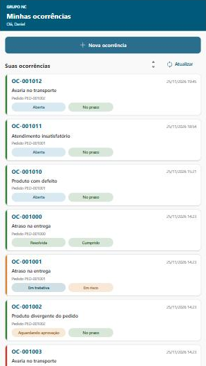 | 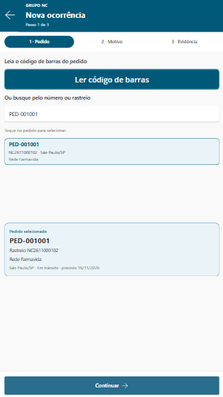 | 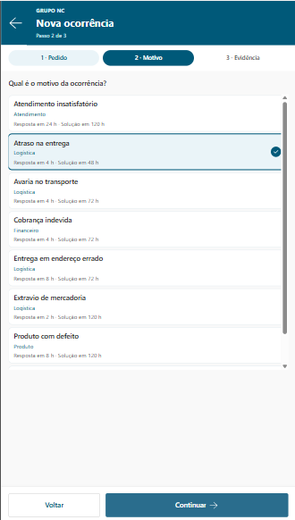 |

| Passo 3: evidência | Confirmação | Detalhe |
|---|---|---|
| 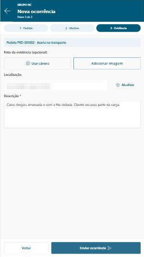 | 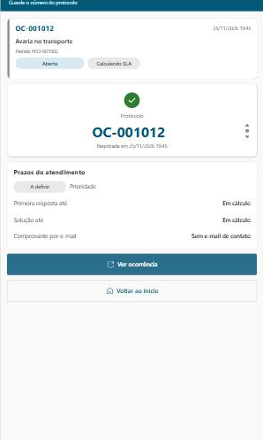 | 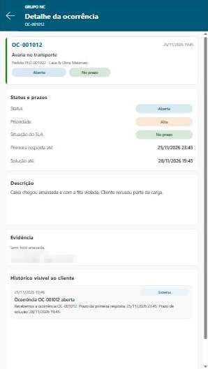 |

---

## 7. Teste de ponta a ponta

A ocorrência **OC-001011** foi aberta pelo NC Campo, com o pedido `NC2611000102` e o motivo "Atendimento insatisfatório", e conferida no Dataverse:

| Etapa | Resultado |
|---|---|
| O app grava a ocorrência | ✅ canal "App de campo", status "Aberta", `nc_idorigem` = `APP-<GUID>`, pedido, motivo, descrição e "Criada por" = usuário do app |
| O fluxo de protocolo responde | ✅ protocolo OC-001011 na tela de confirmação em cerca de 45 s |
| O fluxo de abertura completa | ✅ prioridade **Crítica** (pedido de R$ 12.650), prazos de 24 h e 120 h, SLA "No prazo", cliente, transportadora e a interação de abertura |

Um segundo teste, a **OC-001012** (pedido `NC2611000103`, motivo "Avaria no transporte"), saiu com prioridade **Alta**, primeira resposta em 4 h, solução em 72 h e a interação de abertura. É a ocorrência dos prints do Detalhe.

**O que aprendi:** o gatilho do Dataverse é assíncrono. Ele levou 2 s num teste e 2 min 43 s em outro, e por isso a tela de confirmação pode mostrar os prazos como "Em cálculo". O Detalhe relê o registro e mostra os prazos certos. A melhoria planejada é o fluxo de protocolo calcular os prazos pelo motivo, sem esperar o de abertura.

---

## 8. Publicação e código-fonte

- O NC Campo foi **salvo e publicado** no Studio, dentro da solution.
- O código-fonte dos apps e dos fluxos está neste repositório. Os arquivos de estado local das ferramentas, com URLs e IDs do ambiente, ficaram fora do Git (ver `.gitignore`).
- **Próximo passo (fase 3):** exportar a solution com `pac solution export` e abrir com `pac solution unpack` em `solution/`, com GitHub Actions para empacotar e rodar o Solution Checker a cada push.
